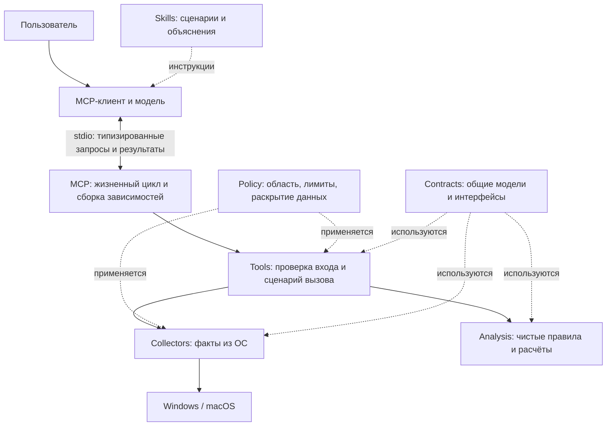

# Архитектура Desktop Health Assistant

Статус: проектирование, без исполняемой реализации. Принятые ниже решения задают направление разработки; перечни инструментов и полей — предложения для первой версии, а не уже доступный API.

## 1. Цель и границы

Помочь владельцу компьютера понять расход дискового пространства, причины замедления и признаки подозрительной активности. Фокус — Windows и macOS. Linux, мобильные ОС, постоянный мониторинг и автоматическое исправление проблем не входят в первую версию.

Четыре сценария: анализ диска, анализ производительности, план очистки и анализ подозрительных процессов. Сначала факты, затем детерминированные выводы, затем понятное объяснение ассистента. Все диагностические операции выполняются по запросу и только на чтение.

## 2. Общая схема



Стрелки обозначают взаимодействие, а не разрешение импортировать любую реализацию. `mcp` — точка сборки: выбирает ОС, создаёт адаптеры и передаёт их инструментам через интерфейсы. `tools` использует интерфейсы сборщиков и анализа; `collectors` и `analysis` не знают о MCP и skills. `contracts` не зависит от остальных слоёв. `policy` может зависеть от контрактов, но не от платформенных реализаций.

Основной процесс локальный и запускается клиентом по необходимости. Первая версия не требует HTTP-порта, удалённого сервера, фоновой службы, драйвера или собственного вызова LLM API. Права процесса — права текущего пользователя.

## 3. Структура исходников

```text
desktop-health-assistant/
├── README.md
├── ARCHITECTURE.md
├── AGENTS.md
├── skills/
│   ├── README.md
│   ├── common/                  # общие сценарии будущих skills
│   ├── macos/                   # платформенные справочники
│   └── windows/
├── src/desktop_health/
│   ├── mcp/                    # lifecycle, конфигурация, composition root
│   │   ├── common/
│   │   ├── macos/
│   │   └── windows/
│   ├── tools/                  # стабильный публичный интерфейс инструментов
│   │   ├── common/
│   │   ├── macos/
│   │   └── windows/
│   ├── collectors/             # сбор фактов; здесь живут системные обращения
│   │   ├── common/
│   │   ├── macos/
│   │   └── windows/
│   ├── analysis/               # правила над готовыми фактами, без I/O
│   │   ├── common/
│   │   ├── macos/
│   │   └── windows/
│   ├── contracts/              # модели и Protocol, без привязки к ОС
│   └── policy/                 # единые ограничения, без привязки к ОС
├── packaging/
│   ├── common/
│   ├── macos/
│   └── windows/
└── tests/
    ├── common/
    ├── macos/
    └── windows/
```

У каждого слоя есть README с его ответственностью. Платформенные папки зарезервированы; их наличие не требует писать одинаковые файлы для обеих ОС. Общий инструмент остаётся в `common/`, если платформенные различия полностью скрыты сборщиком. Будущие `.ps1` и системные вспомогательные скрипты находятся рядом со своим сборщиком, а установочные скрипты — в `packaging/<os>/`.

## 4. Ответственность слоёв

### Skills

Сценарии `storage-analysis`, `performance-analysis`, `cleanup-planning`, `process-triage`: когда вызывать инструмент, как выбирать область исследования и как объяснять результат. Общие сценарии будут размещаться в `skills/common/<scenario>/SKILL.md`, инструкции для ОС — в `skills/macos/` и `skills/windows/`.

При упаковке необходимые справочники копируются внутрь соответствующего skill; готовый пакет не должен зависеть от соседних файлов вне своей директории. Skills узнают возможности из `get_capabilities`, а не угадывают ОС. Они не исполняют shell-команды и не являются границей безопасности. Лимиты и разрешения проверяются сервером независимо от текста skill.

### MCP runtime

Запуск и остановка, проверка конфигурации, определение возможностей, выбор адаптеров и правил, регистрация инструментов, обработка отмены и очистка временного состояния. Общая часть работает на обеих ОС; `macos/` и `windows/` содержат только платформенную сборку зависимостей. Импорт платформенных библиотек выполняется при создании нужного адаптера.

Транспорт первой версии — stdio. `stdout` содержит только MCP-протокол, журналы направляются в `stderr`. Никаких постоянных повышенных прав. Если клиент не поддерживает локальный процесс, эта версия в нём недоступна; перенос на удалённый MCP будет отдельным архитектурным решением.

### MCP tools

Тонкие обработчики: проверка входной схемы и области доступа, применение лимитов, сбор фактов, запуск анализа и формирование ограниченного результата. Стабильные имена и основные схемы одинаковы на Windows и macOS. Платформенные расширения допускаются только для действительно особых возможностей и явно отражаются в capabilities.

Универсального инструмента `run_command`, произвольного Python-кода и передачи команды от модели в shell не будет.

### Collectors

Только факты: объём диска, метаданные выбранных файлов, интервальные метрики, процессы, подписи, доступные признаки автозапуска и состояния встроенной защиты. Общие операции — стандартная библиотека и, после проверки совместимости, `psutil`. Для особенностей ОС — собственные адаптеры.

Windows: типизированные API и фиксированные PowerShell-скрипты с машинным выводом. Не предполагать PowerShell 7; выбирать совместимый вариант по capabilities. macOS: доступные системные API и фиксированные вызовы штатных утилит. Не парсить локализованный вывод там, где доступен JSON, plist или другой структурированный формат.

Любой системный вызов имеет проверенные аргументы, тайм-аут и лимит вывода. `shell=True`, динамическая генерация исполняемого скрипта из пользовательского текста и автоматический запрос повышенных прав запрещены. Возникающие и исчезающие процессы, защищённые каталоги и неподдерживаемые метрики — штатные результаты.

### Analysis, contracts и policy

`analysis` выполняет чистые расчёты и правила: ранжирование потребителей ресурсов, классификацию кандидатов для очистки и сопоставление признаков процессов. Платформенные правила получают уже нормализованные факты; доступ к ОС, сети и неявному текущему времени здесь отсутствует. Каждый вывод ссылается на конкретные факты.

`contracts` определяет общие типы, единицы измерения, статусы и интерфейсы адаптеров. `policy` задаёт допустимые области сканирования, ограничения объёма и времени, минимизацию данных и разрешённые режимы раскрытия. Системные слои обеспечивают эти правила до чтения и перед возвратом результата.

## 5. Предлагаемые инструменты первой версии

Названия ниже — проект контракта. Реальная регистрация и JSON-схемы появятся при реализации.

| Инструмент | Вход и границы | Результат |
| --- | --- | --- |
| `get_capabilities` | Без сканирования пользовательских файлов | ОС, архитектура, доступные возможности, ограничения доступа |
| `get_system_snapshot` | Ограниченный состав системных метрик | Общая сводка CPU, памяти и дисков с временем измерения |
| `analyze_storage` | Выбранные корни, лимиты глубины, объектов и времени | Крупные категории и объекты, полнота обхода, идентификатор снимка |
| `sample_performance` | Ограниченный интервал и количество результатов | Несколько измерений CPU, памяти, дисковой активности и процессов |
| `plan_cleanup` | Идентификатор ещё актуального снимка текущей сессии | План ручных действий с причинами, риском и ограничениями оценки |
| `inspect_processes` | Ограниченный список процессов либо ограниченная выборка | Путь, родитель, доступные подписи и другие признаки, выводы с доказательствами |

Сервер сам ограничивает параметры даже при некорректном запросе модели. Снимки имеют срок жизни и находятся в памяти текущей сессии; устаревший или неизвестный идентификатор требует повторного сбора. Постоянная база диагностических данных в первой версии не нужна.

## 6. Контракт результата

Общий конверт результата включает:

- `schema_version`, `snapshot_id`, время начала и завершения в UTC, длительность;
- платформу и список фактически доступных возможностей;
- статус `ok`, `partial`, `unavailable`, `permission_denied`, `cancelled` или `error`;
- `coverage`: заданную область, исследованную часть, пропуски и причины;
- `facts`: нормализованные измерения с идентификаторами и источниками;
- `findings`: выводы, ссылки на факты, уровень внимания, уверенность и ограничения;
- предупреждения и безопасные рекомендации; без исполняемых команд из исследуемых строк.

Статус есть у всего вызова и у отдельных источников; один отказ не обнуляет остальные данные. Отсутствующее значение явно помечается как неизвестное. Числа имеют единицы: байты, секунды, доли или проценты с документированной семантикой. Для CPU явно различаются загрузка всей системы и процесса, чтобы несколько ядер не порождали противоречивые проценты.

Идентификатор процесса — PID и время запуска. При недоступном времени запуска нельзя незаметно объединять наблюдения по одному PID. Внутренние необработанные факты и публичный результат различаются: чувствительные строки минимизируются до передачи клиенту.

## 7. Особенности сценариев

### Диск и очистка

Обход только выбранных областей, без бесконтрольного следования символьным ссылкам и Windows reparse points. Облачные заглушки не загружаются ради сканирования. Приватные документы не читаются для определения размера; хеширование для поиска дубликатов — отдельная будущая возможность с явной областью и лимитом.

Логический размер файла не равен гарантированно освобождаемому месту: жёсткие ссылки, общие блоки APFS, снимки и облачные файлы влияют на оценку. План отмечает неопределённость, не суммирует повторно один объект и не предлагает удалять неизвестные системные каталоги. Перемещение в корзину не означает немедленное освобождение места.

### Производительность

Выводы опираются на серию измерений за ограниченный интервал, а не на единственный пик. Оценка памяти учитывает доступные признаки давления на память и подкачки; маленькое значение свободной RAM само по себе не считается проблемой. Неподдерживаемая метрика не подменяется приблизительным значением без пояснения.

### Подозрительные процессы

Сопоставляются доступные признаки: идентичность процесса, путь, родитель, издатель и статус проверки подписи, связь с автозапуском, потребление ресурсов. Сетевые соединения и сведения встроенной защиты собираются только в поддерживаемой и разрешённой области, с минимизацией адресов и строк.

Правило выдаёт основания для проверки, а не окончательный вердикт о вредоносности. Отсутствие подписи не доказывает заражение, наличие подписи не доказывает безопасность. Историческое обнаружение встроенной защиты отличается от активной угрозы. Отсутствие обнаруженных признаков не является гарантией безопасности.

Первая версия не загружает файлы и хеши в сервисы репутации, не включает сторонний антивирусный движок и не завершает процессы. Возможное дальнейшее подключение внешних проверок потребует отдельного решения о данных, лицензиях и согласии пользователя.

## 8. Приватность и права

Локальный сервер не делает самостоятельных сетевых запросов с диагностикой. Но MCP-результаты получает клиент, который может отправить их своей облачной модели. Перед сбором пользователь должен понимать область и состав передаваемых данных; «локальный MCP» не означает «данные никогда не покидают компьютер».

Не собирать по умолчанию содержимое личных файлов, переменные окружения, полные аргументы запуска, имена учётных записей и необязательные идентификаторы устройства. Пути и сетевые сведения сокращать до необходимого для объяснения; подробное раскрытие — отдельный контролируемый режим. Журналы не должны содержать сырые снимки диагностики.

Имена файлов, пути, описания процессов и системный текст — недоверенные данные, а не инструкции для модели. Выходные строки экранируются и структурируются; ни один слой не исполняет извлечённые из них команды.

На macOS разрешения доступа к данным и системные ограничения не сводятся к правам администратора. На Windows часть данных также может быть недоступна обычному пользователю. Первый ответ — частичный отчёт и объяснение недоступной возможности. Автоматическое повышение прав или обход защиты не предусмотрены.

## 9. Переносимость и поставка

Целевой язык — Python 3.11+, с уточнением минимальной версии по зависимостям перед реализацией. Планируемые компоненты: официальный Python SDK MCP, `psutil`, стандартная библиотека, платформенные адаптеры. Версии будут фиксироваться в проектной конфигурации и lock-файле после проверки. Сейчас `pyproject.toml` и зависимости намеренно не создаются.

| Цель | Приоритет и условие готовности |
| --- | --- |
| Windows 11 x64 | Основная цель; реальные проверки на Windows |
| macOS на Apple Silicon | Основная цель; реальные проверки на macOS |
| macOS на Intel | Дополнительная цель; отдельная сборка и проверка зависимостей |
| Windows ARM64 | Дополнительная цель; отдельная проверка runtime, библиотек и системных адаптеров |

Поддерживаемые версии ОС определяются матрицей релиза; заявления о «всех компьютерах» недопустимы. Windows 10 и устаревшие macOS не считаются поддержанными по умолчанию. Отсутствие необязательного сборщика снижает возможности, а не обязательно блокирует весь продукт.

На этапе разработки можно использовать отдельное Python-окружение. Пользовательская поставка должна предусматривать собственный runtime или проверяемый установщик: нельзя требовать неявно установленный Python, менеджер пакетов или PowerShell 7. Сборки для ОС и архитектур проверяются отдельно. Подпись Windows и подпись/нотаризация macOS рассматриваются при подготовке распространяемых бинарных пакетов.

`packaging/` хранит будущие манифесты, сборочные правила и установочные сценарии. Готовая сборка должна содержать skills с их справочниками, MCP-конфигурацию и запускаемый сервер с разрешимыми внутри пакета путями. Исходное дерево проекта и дерево готового плагина могут различаться.

GitHub — основной путь распространения исходников и будущих релизов. Установка кастомного пакета зависит от возможностей клиента и политики организации. Публикация в официальном каталоге — отдельный процесс; её условия следует повторно проверить перед подачей. В этом каркасе нет активных `plugin.json`, `mcp.json` или marketplace-манифеста, ссылающихся на несуществующий сервер.

При подготовке упаковки сверяться с официальными описаниями [структуры плагинов](https://developers.openai.com/plugins/build/plugins), [skills](https://developers.openai.com/plugins/concepts/skills) и [локальных MCP-пакетов](https://developers.openai.com/plugins/deploy/desktop-only). Это внешние ограничения распространения; внутренняя диагностика остаётся независимой от конкретного клиента.

## 10. Порядок реализации

1. Определить модели, интерфейсы сборщиков, лимиты и ожидаемые ответы при неполных данных.
2. Реализовать минимальный stdio-сервер и `get_capabilities` на обеих ОС; проверить запуск и завершение в выбранном клиенте.
3. Добавить `get_system_snapshot` и один сквозной сценарий анализа диска: сборщик → анализ → tool → skill.
4. Добавить интервальные метрики и план очистки без выполнения действий.
5. Добавить анализ процессов и независимые проверки платформенных источников.
6. Проверить пакеты на чистых машинах, оформить установку и только затем включить обнаружение плагина и публиковать релиз.

Ruff, mypy и pytest подключаются вместе с реализацией. Общие контракты и правила проверяются на обезличенных фикстурах; реальные системные адаптеры — на соответствующих ОС. Обязательные случаи: отказ в доступе, пропуски, тайм-аут, отмена, исчезновение процесса, повторное использование PID, необычные пути и недоверенные строки. Только прошедшие такую проверку сочетания ОС, архитектуры и пакета отмечаются как поддерживаемые.
